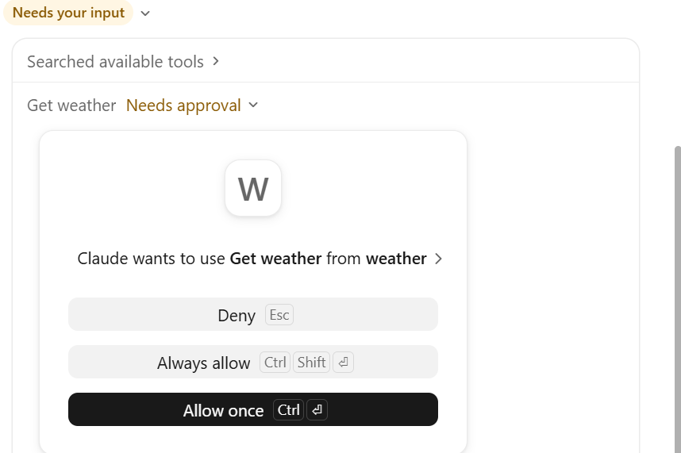
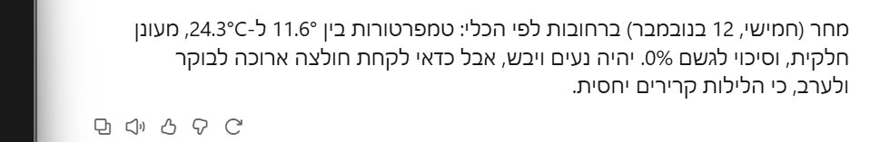

# Weather MCP Server

שרת MCP פשוט שנותן ל-Claude (דרך Claude Desktop) את היכולת להביא מזג אוויר נוכחי ותחזית לכל עיר בעולם.
הנתונים מגיעים מ-[Open-Meteo](https://open-meteo.com/), שירות חינמי שאינו דורש מפתח API.

## מה זה MCP?

Model Context Protocol הוא פרוטוקול שמאפשר למודל שפה להפעיל "כלים" חיצוניים.
כאן הכלי הוא פונקציה בשם `get\_weather`, ו-Claude מפעיל אותה כשמבקשים ממנו מזג אוויר.

## הכלי

|כלי|פרמטרים|תיאור|
|-|-|-|
|`get\_weather`|`city` (שם העיר), `days` (1 עד 7, ברירת מחדל 3)|מחזיר מזג אוויר נוכחי ותחזית יומית|

## איך זה עובד

1. הפונקציה מקבלת שם עיר ומבקשת מ-Open-Meteo את הקואורדינטות שלה (geocoding).
2. עם הקואורדינטות היא מבקשת את מזג האוויר הנוכחי ואת התחזית.
3. היא מחזירה טקסט מסודר, ו-Claude מנסח ממנו תשובה למשתמשת.

## התקנה

דרישות: Python 3.10 ומעלה.

```
pip install -r requirements.txt
```

ב-Windows אם `pip` לא מזוהה:

```
py -m pip install -r requirements.txt
```

הערה: הקוד כתוב עבור גרסה 1 של ספריית `mcp` (לכן `<2` ב-requirements.txt).

## חיבור ל-Claude Desktop

1. ב-Claude Desktop: Settings ← Developer ← Edit Config.
2. מוסיפים לקובץ `claude\_desktop\_config.json` (מחליפים את הנתיב בנתיב האמיתי):

```json
{
  "mcpServers": {
    "weather": {
      "command": "py",
      "args": \["C:\\\\path\\\\to\\\\weather\_server.py"]
    }
  }
}
```

3. סוגרים את Claude Desktop לגמרי (File ← Exit) ופותחים מחדש.
4. שואלים למשל: "תשתמשי בכלי get\_weather ותגידי לי מה מזג האוויר בתל אביב".
Claude יבקש אישור להפעלת הכלי.

## בדיקה בלי Claude

```
py weather\_server.py
```

אם אין שגיאה והחלון ממתין, השרת תקין (יציאה עם `Ctrl+C`).

## מבנה הפרויקט

```
weather\_server.py   קוד השרת
requirements.txt    הספריות הנדרשות
README.md           הקובץ הזה
```

## מחברת

שם: שיפי פינסקי.  
## צילומי מסך



